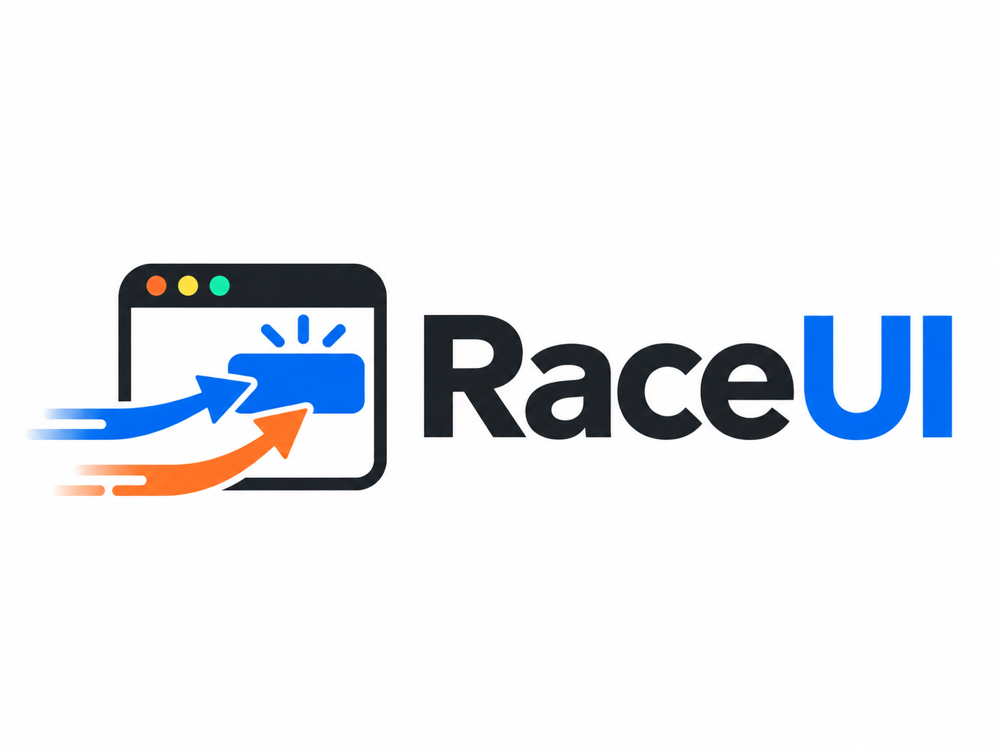

<p align="center">
  
</p>

<h3 align="center">Two users. One resource. Zero room for bugs.</h3>

<p align="center">
  A lightweight, agent-friendly concurrency testing toolkit for discovering race conditions<br>
  and business-logic conflicts through <b>real browser interactions</b>.
</p>

---

RaceUI prepares 2–5 independent browser sessions, holds them at a readiness barrier, releases one
competing UI action per session with controlled timing, repeats the experiment, and verifies that
your business invariants still hold — with timing data, screenshots and sanitized request metadata as
evidence.

It is **not** a general E2E framework, a load-testing tool or an AI agent. It uses Playwright as the
browser engine, runs locally or in CI, and needs no LLM, API key, cloud service, dashboard or
database.

```text
      ▄████████████████████   ██████╗  █████╗  ██████╗███████╗██╗   ██╗██╗
      █████████████████████   ██╔══██╗██╔══██╗██╔════╝██╔════╝██║   ██║██║
      ██         █▄ ██▄█  █   ██████╔╝███████║██║     █████╗  ██║   ██║██║
      ██       ▄▄▄██████▄▄█   ██╔══██╗██╔══██║██║     ██╔══╝  ██║   ██║██║
      ██    ███████████████   ██║  ██║██║  ██║╚██████╗███████╗╚██████╔╝██║
  ▄▄▄▄██▄████████████████▀█   ╚═╝  ╚═╝╚═╝  ╚═╝ ╚═════╝╚══════╝ ╚═════╝ ╚═╝
▄████████▀▀▀     ███▀     █   Two users. One resource. Zero room for bugs.  v0.1.0
    ▄▄▄▄▄▄▄▄▄▄███▀▀▀      █
  ▄▄██████████▀███████████▀
```
<sub>The CLI banner (shown by <code>raceui</code>, <code>raceui --help</code>, <code>raceui init</code> and <code>raceui run</code>) is rendered from
<code>assets/raceui-logo.png</code> in truecolor when the terminal supports it. Disable with <code>NO_COLOR=1</code> or <code>raceui run --no-logo</code>.</sub>

## What it catches

| Pattern | Example | Invariant (you declare it) |
|---|---|---|
| Double booking | Two users reserve one seat | Exactly one committed booking |
| Overselling | Two customers buy the last item | At most one order; stock never negative |
| Duplicate submission | Same account submits from two devices | At most one logical operation |
| Double spending | Concurrent wallet debit | Total debit ≤ available balance |
| Concurrent approval | Two approvers process one request | Exactly one state transition |
| Lost update | Two users edit one record | Final state follows the conflict policy |

## Quickstart (≈5 minutes)

Requirements: Node.js 22+.

```bash
git clone https://github.com/modalqa/raceUI.git && cd raceUI
npm install && npm run build
npx raceui install-browser            # downloads Playwright Chromium once
```

Start the bundled **deliberately vulnerable** playground in one terminal:

```bash
npx raceui-playground --mode vulnerable     # http://127.0.0.1:3000
```

Run the double-booking scenario in another:

```bash
# bash / zsh
export RACEUI_FIXTURE_TOKEN=dev-token
# PowerShell:  $env:RACEUI_FIXTURE_TOKEN = "dev-token"

npx raceui run examples/booking.yaml --repeat 3
```

Actual output from that run (logo banner omitted):

```text
Attempt 01: FAIL - GET /test-support/seat-01/booking-count#/count: expected 1, observed 2
...
RaceUI v0.1.0
Scenario: concurrent-seat-booking
Actors: 2 | Requested attempts: 3 | Seed: 42

PASS          0
FAIL          3
INCONCLUSIVE  0

Attempt 01: FAIL (invariant-violation)
  Browser action dispatch skew: 0.3 ms [within-threshold, threshold 100 ms]
  FAIL ui:"Booking successful"
    Expected: 1  Observed: 2 (user-a, user-b)
  FAIL ui:"Seat unavailable"
    Expected: 1  Observed: 0
  FAIL GET /test-support/seat-01/booking-count#/count
    Expected: 1  Observed: 2
  Note: Observed violation is client-side evidence; it does not by itself prove the server-side cause.
  Evidence: attempt-001/
...
Result: FAIL (exit 1)
Report: artifacts/raceui/20261125-004333-c555e5/report.json
```

Now restart the playground with `--mode fixed` (atomic reservation) and run again: every attempt
passes with exactly one booking and one `Seat unavailable` (exit `0`).

Start your own scenario with:

```bash
npx raceui init                 # writes ./raceui.yaml with inline instructions (never overwrites without --force)
npx raceui validate raceui.yaml
npx raceui run raceui.yaml
```

## How an attempt works

```text
Validate configuration and target policy
  -> Reset fixture (or create a unique resource) -> verify baseline
  -> Create one isolated BrowserContext per actor
  -> Prepare actors in parallel -> check race locator is unique, visible, enabled
  -> Readiness barrier (no partial release: all actors or none)
  -> Release: one click/press per actor at its planned offset (never retried)
  -> Wait for in-flight requests, settle, poll assertions within a bounded window
  -> Classify PASS / FAIL / INCONCLUSIVE -> capture evidence -> close contexts
```

The barrier is a client-side software synchronization point — RaceUI measures browser dispatch skew
and records browser-observed request timing, but never claims server-side simultaneity.

## CLI

```bash
raceui install-browser [--with-deps]       # Playwright Chromium (Linux CI: --with-deps)
raceui init [path] [--force]
raceui validate <file> [--repeat n] [--allow-origin o] [--json]
raceui run <file> [options]
```

| Option (`run`) | Behavior |
|---|---|
| `--repeat <n>` | Override repeat count (1–100) |
| `--seed <n>` | Override the deterministic schedule seed |
| `--headed` | Show browser windows for debugging |
| `--output <dir>` | Parent directory for the unique run directory (default `artifacts/raceui`) |
| `--evidence <mode>` | `on-failure` (default), `always`, `none` |
| `--stop-on-fail` | Stop after the first confirmed FAIL; later attempts are reported as SKIPPED |
| `--allow-origin <origin>` | Authorize a non-loopback test origin (repeatable) |
| `--json` | Print the JSON report to stdout |
| `--no-logo` | Hide the banner |

### Exit codes

| Code | Meaning |
|---:|---|
| 0 | All requested attempts PASS |
| 1 | One or more confirmed invariant violations (FAIL) — wins over INCONCLUSIVE |
| 2 | Invalid scenario/configuration, bad CLI usage, or unapproved target origin |
| 3 | No confirmed violation, but attempts INCONCLUSIVE or not completed |
| 130 | Interrupted (Ctrl+C); contexts are closed and a partial report is written |

CI runs never prompt. Loopback targets are allowed by default; anything else must be passed with
`--allow-origin` at invocation — a scenario file cannot authorize itself.

## Scenario reference

```yaml
version: 1
name: concurrent-seat-booking
baseUrl: http://127.0.0.1:3000           # every path below is relative to this origin

actors:                                  # 2–5 actors, unique ids, each in its own BrowserContext
  - id: user-a
    storageState: ./auth/user-a.json     # optional Playwright storage state (relative to this file)
    prepare:                             # navigate | fill {selector,value} | click | waitFor (visible)
      - navigate: /booking/seat-01
      - waitFor: '[data-testid="confirm-booking"]'
    race:                                # exactly one: click: <selector> | press: {selector, key}
      click: '[data-testid="confirm-booking"]'
  - id: user-b
    storageState: ./auth/user-b.json
    prepare:
      - navigate: /booking/seat-01
    race:
      click: '[data-testid="confirm-booking"]'

fixtures:                                # required (reset or unique + baseline) when repeat > 1
  strategy: reset                        # reset | unique
  # resourceTemplate: seat-${RUN_ID}-${ATTEMPT}    # strategy unique -> use ${RESOURCE_ID}
  setup:  { method: POST, path: /test-support/setup }           # optional, once per run
  reset:
    method: POST
    path: /test-support/reset
    headers: { Authorization: 'Bearer ${RACEUI_FIXTURE_TOKEN}' }
  baseline:
    get: /test-support/seat-01/booking-count
    headers: { Authorization: 'Bearer ${RACEUI_FIXTURE_TOKEN}' }
    pointer: /count
    equals: 0

timing:
  mode: simultaneous                     # simultaneous | staggered (offsetsMs) | jitter (jitterMs, seeded)
  maxDispatchSkewMs: 100                 # simultaneous: skew; others: deviation from planned offsets
  barrierTimeoutMs: 30000
  prepareTimeoutMs: 30000
  actionTimeoutMs: 5000
  requestFilter: { method: POST, path: /api/bookings }   # optional: labels the target request

assertions:
  settleMs: 500
  timeoutMs: 5000                        # bounded observation window; last observation is reported
  pollMs: 250
  checks:
    - ui: { text: Booking successful, count: { equals: 1 } }  # distinct actor pages with exact visible text
    - ui: { actor: user-b, text: Seat unavailable }           # one actor (count defaults to equals: 1)
    - api:
        get: /test-support/seat-01/booking-count              # read-only GET
        headers: { Authorization: 'Bearer ${RACEUI_FIXTURE_TOKEN}' }   # or actor: user-a (its cookies)
        pointer: /count                                       # RFC 6901 JSON Pointer
        equals: 1                                             # equals | notEquals | min | max

run:
  repeat: 20                             # default 1, max 100; attempts are sequential
  seed: 42                               # default: random (always recorded in the report)
  browser: chromium
  evidence: on-failure                   # on-failure | always | none
```

Rules enforced before any browser starts: unknown keys, duplicate actor ids, missing references,
unsupported actions, absolute URLs, out-of-range limits and unresolved `${VAR}` placeholders are
rejected. `${RUN_ID}`, `${ATTEMPT}` and `${RESOURCE_ID}` are resolved per attempt.

More examples: [examples/booking.yaml](examples/booking.yaml),
[examples/booking-unique.yaml](examples/booking-unique.yaml) (unique resources + seeded jitter),
[examples/duplicate-attendance.yaml](examples/duplicate-attendance.yaml) (same account, staggered),
[examples/lost-update.yaml](examples/lost-update.yaml) (optimistic-locking policy).

## Results and evidence

| Result | Meaning |
|---|---|
| **PASS** | All invariants held, actions completed, timing within the threshold. Only means no violation was *detected*. |
| **FAIL** | An invariant was observably violated. `failureKind: invariant-violation` when an authoritative API check failed; `ui-outcome-mismatch` when only UI text disagreed. |
| **INCONCLUSIVE** | Invalid baseline, reset failure, readiness timeout, locator/action error, verification endpoint unavailable, timing threshold exceeded, or missing required evidence. |
| **SKIPPED** | Not executed (`--stop-on-fail`, unsafe continuation after reset/baseline failure, interrupt). |

```text
artifacts/raceui/<run-id>/
  report.json              # schemaVersion 1: every attempt, per-actor timing, assertions, fixture status,
                           # errors, environment/browser version, redacted resolved config
  attempt-005/
    user-a.png  user-b.png # full-page screenshots per actor
    requests.json          # sanitized browser-side request metadata (no bodies)
    timing.json            # planned vs. actual offsets, dispatch/completion times
```

Evidence paths in the report are relative to the run directory. A partial `report.json` is rewritten
after every attempt.

## Using RaceUI from coding agents

The portable skill lives at [skills/raceui/SKILL.md](skills/raceui/SKILL.md). It teaches an agent to
find the shared resource and invariant, confirm an authorized environment, author the smallest
scenario, run the CLI, and report only what the JSON report says.

| Agent | Installation | Verification status |
|---|---|---|
| Claude Code | Copy `skills/raceui/` to `.claude/skills/raceui/` in your project (or `~/.claude/skills/raceui/`) | Format follows Agent Skills; end-to-end run not yet verified for v0.1 |
| OpenAI Codex | Copy `skills/raceui/` to `.agents/skills/raceui/` (or reference `SKILL.md` from `AGENTS.md`) | Not yet verified |
| Cursor | Reference `skills/raceui/SKILL.md` from a project rule (`.cursor/rules/`) or `AGENTS.md` | Not yet verified; documented fallback |
| Other agents | Point the agent at `SKILL.md` and the `raceui` CLI | — |

Example prompt:

> Use the RaceUI skill to test concurrent employee attendance in our authorized staging
> environment. Prepare two isolated browser sessions for the same employee. Coordinate clock-in
> submissions, repeat the experiment with a fresh attendance fixture, and verify that at most one
> attendance record is committed. Return observed results, timing limitations and evidence paths.
> Do not change application code.

## Safety

- Only test applications you are authorized to test, with synthetic users and disposable data.
  Non-loopback origins require `--allow-origin`.
- Browser requests to unapproved origins are aborted and service workers are blocked (best effort —
  not a network sandbox). Fixture and API calls never follow redirects.
- Scenario files cannot run shell commands or JavaScript. Secrets come from `${ENV}` placeholders and
  are redacted from reports along with authorization/cookie headers and sensitive query parameters.
  Screenshots can still show sensitive UI — keep artifacts private.
- Never commit storage-state files or artifacts. Suggested `.gitignore`:

  ```gitignore
  auth/
  artifacts/
  ```

- No telemetry, uploads or AI requests. See [SECURITY.md](SECURITY.md).

## Known limitations (v0.1)

- Chromium only; one race action per actor per attempt; 2–5 actors; up to 100 sequential attempts.
- Simultaneous dispatch in the browser does not guarantee simultaneous arrival at the server.
  Replaying a seed reproduces planned offsets, not OS scheduling, network behavior or server ordering.
- Narrow race windows may need more repeats or jitter; passing runs never prove absence of races.
- Playwright actionability checks add latency between dispatch and the actual click (visible as
  `completedMs` and request `startMs` in the report).
- Not yet implemented (P1): opt-in Playwright traces and a static HTML report.
- Performance targets in the PRD (e.g. p95 dispatch skew ≤ 50 ms) have not been benchmarked on
  reference hardware yet; the report always shows the measured values.

## Development

```bash
npm install
npm run build             # TypeScript -> dist/
npm test                  # unit tests (barrier, scheduler, schema, classification, redaction, policy)
npm run test:integration  # Playwright against vulnerable/fixed playgrounds (needs Chromium)
npm run logo              # regenerate the terminal logo from assets/raceui-logo.png (Python + Pillow)
```

Project layout: `src/cli` (commands, banner), `src/schema` (YAML + Zod validation),
`src/engine` (runner, sessions, barrier, scheduler, fixtures), `src/assertions`, `src/evidence`,
`src/reporters`, `src/security`, `playground/`, `examples/`, `skills/raceui/`, `tests/`.

See [CONTRIBUTING.md](CONTRIBUTING.md) and [CHANGELOG.md](CHANGELOG.md).

## License

[MIT](LICENSE)
